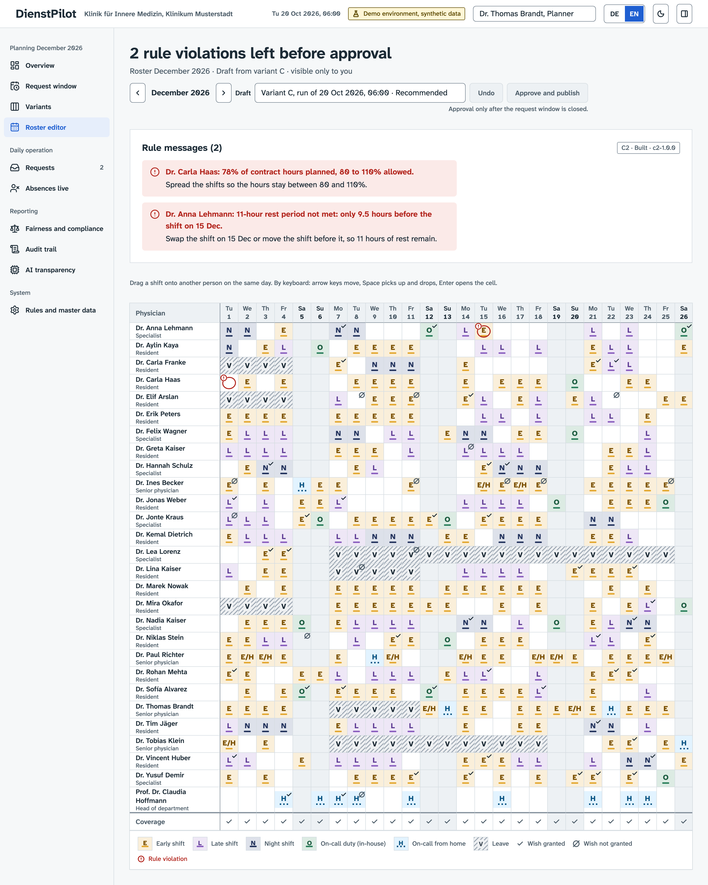
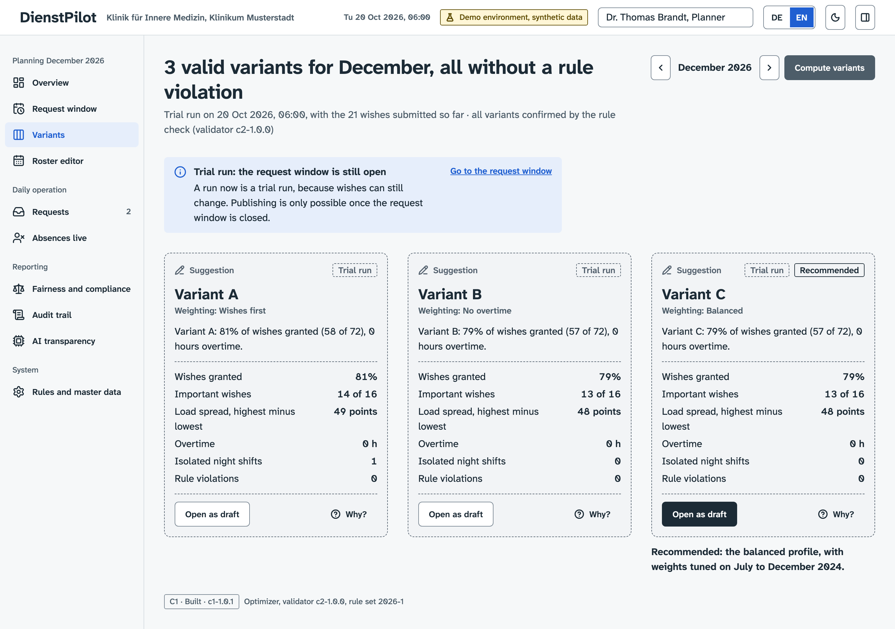
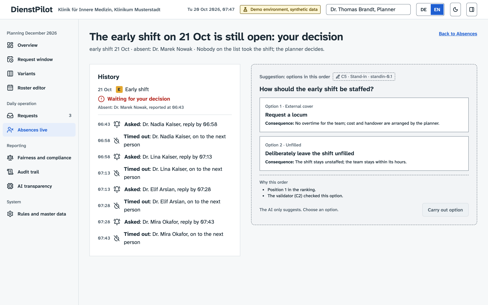
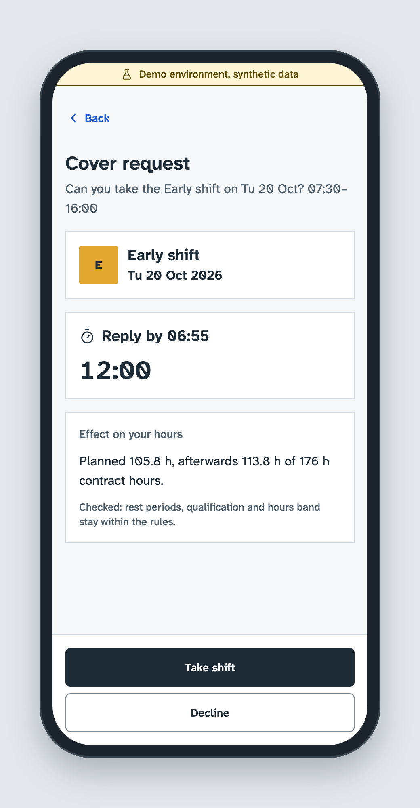
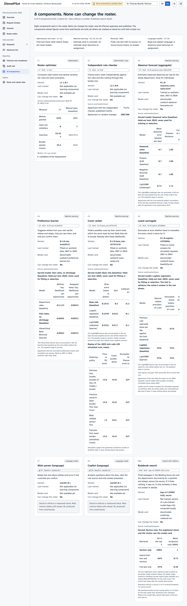
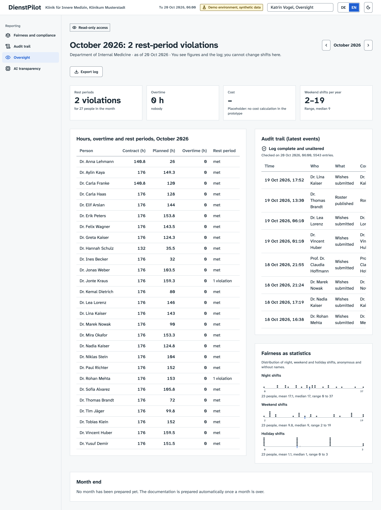
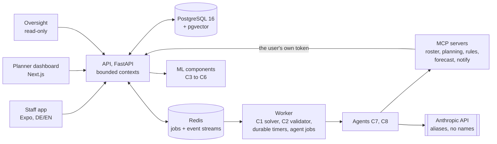

# DienstPilot

**AI-assisted duty scheduling for German hospital departments. The AI proposes; a responsible physician approves.**

DienstPilot (KI-gestützte Dienstplanung für Kliniken) proposes monthly duty rosters, handles leave requests, shift swaps and sick-call cover, and prepares the compliance documentation for payroll and the works council. It is a **portfolio prototype**: every screen runs against the real backend, every number on this page comes from a script in this repository, and **all data is synthetic**, for a fictional department ("Klinik für Innere Medizin, Klinikum Musterstadt"). It has not been used by any hospital, and nothing here claims otherwise.

| | |
|---|---|
|  |  |
| **W4** Roster editor: a change that breaks the 11-hour rest rule is flagged in plain words, with its fix | **W3** Two to three complete, valid variants from a real solver run, one marked as recommended |
|  |  |
| **W7b** Nobody answered in time: the Planner gets the ranked options, not an empty problem | **M8** The cover request a colleague gets at 06:43, with a deadline |
|  |  |
| **W13** One card per component with its real status and measured results | **W12** Oversight: read-only compliance, overtime and anonymous fairness |

More screens, in German and English, light and dark: [screenshots/INDEX.md](screenshots/INDEX.md).

## The problem

In most hospital departments one senior physician builds the monthly duty roster by hand, the better part of a weekend, every month. Wishes arrive by e-mail, WhatsApp and sticky note. When someone calls in sick at 06:40, the same physician spends the morning on the phone. Nobody can see how nights and weekends are distributed, so the roster is a recurring source of friction.

The process this prototype implements is written down in [docs/PROCESS.md](docs/PROCESS.md): the roles (staff, senior staff, planner, oversight, administrator), who approves what, the monthly cycle, and three situations told the way they happen: a doctor asks for two weeks off, two doctors exchange a shift, a doctor calls in sick at 06:40. It was designed from the duty-roster workflow of a hospital department. A pilot (one department, one month, in parallel with the existing method) is **designed but not run**, so the time saved for a planner is a hypothesis, not a result.

## How it works, and why the parts are kept apart



Eight components, three kinds of tool, never mixed:

| | Component | Kind | Role |
|---|---|---|---|
| C1 | Roster optimizer | constraint optimization (OR-Tools CP-SAT) | Decides assignments and feasibility. Hard rules are constraints; wishes, fairness and overtime are the objective. |
| C2 | Rule validator | deterministic, written independently of C1 | Checks every plan and every change against the same rules. Nothing reaches the database without it. |
| C3 | Absence forecast | ML, department level only | Estimates absences per day, never for a person. |
| C4 | Preference learner | ML | Suggests wishes from a person's own history; the person confirms. |
| C5 | Cover ranker | ML plus a fairness policy | Orders whom to ask first for a sick call. |
| C6 | Leave feasibility | ML trained on solver answers | An advisory hint; the solver's answer is the one shown. |
| C7 | Request intake | LLM, structured output | Turns free text into a preview the person confirms. |
| C8 | Planner copilot | LLM agent over MCP tools | Checks what-ifs and drafts wording; can only create proposals. |

The rule behind the split: **the optimizer decides, ML estimates what is uncertain, language models only read and explain.** A guess can never become a broken rule, and a sentence can never become a shift. An LLM never produces an assignment, no agent has a publish or approve tool, and agents act with the signed-in user's own permissions. Only the responsible physician can approve and publish a roster (or set the policy under which swaps and cover are confirmed automatically, which is logged as such). Details: [docs/ARCHITECTURE.md](docs/ARCHITECTURE.md) and the [architecture decision records](docs/adr).

Other things worth looking at: a hash-chained audit trail with a real verification (W10), durable workflows and timers that run on a demo clock and fire exactly once, events through a transactional outbox, privacy by construction (no diagnosis field anywhere; ML features and LLM prompts use pseudonymous ids; people are aliases in everything sent to a model, free text is delimited, and every number an agent states must be grounded in its tool results), and a design system with German and English strings and WCAG checks in the end-to-end tests.

## Results

Every result below is computed by a script in `eval/` and read from `eval/results/*.json`; the block is rendered by `eval/render_readme.py` and CI fails if it drifts from the files. Rules for promoting a learned model were committed **before** the held-out year (2025) was scored, and each held-out set was scored once.

<!-- results:start -->
*Generated by `eval/render_readme.py` from `eval/results/*.json`. Do not edit by hand.*

### The optimizer against the manual roster (C1, held-out months 2025-01-01..2025-12-01)

| Measure | Manual roster (simulated baseline) | C1 (recommended variant) |
|---|---|---|
| Hard-rule violations, published rosters (counted by C2) | 5 | 0 |
| Wishes granted | 39.6 % | 62.8 % |
| Important wishes granted | 41.0 % | 63.9 % |
| Overtime hours (sum over the months) | 492.75 | 55.45 |
| Burden spread (mean per month) | 43.5 | 35.42 |
| Isolated single nights | 90 | 26 |

The independent validator (C2) agrees with the second checker on 71/71 published months and 300/300 random changes. Median solve time 1.41 s per variant (wall clock on one machine).

### Where the simple model won

Each learned component was compared with a simple baseline by a rule written before the held-out year (2025) was scored. None of the four learners was promoted.

| Component | Simple baseline (served) | Challenger | Held-out result |
|---|---|---|---|
| C3 absence forecast | seasonal naive: MAE 0.701, deviance 1.060 | LightGBM: MAE 0.722, deviance 1.118 | baseline better; not promoted |
| C4 preference learner (wish / avoid log-likelihood, higher is better) | raw rates: -0.0866 / -0.0652 | hierarchical: -0.0864 / -0.0633 | differences inside the bootstrap interval; not promoted |
| C5 cover ranker (acceptance, Brier, lower is better; AUC) | base rate: 0.2531; AUC 0.50 | LightGBM: 0.2551; AUC 0.517 | no gain; not promoted |
| C6 leave feasibility (precision / recall of a yes, pooled with simulated stress states) | logistic regression: 0.982 / 0.831 | LightGBM: 0.992 / 0.795 | precision margin not met, recall lower; not promoted |
| Rule search recall@5 (37 answerable test questions) | vectors alone: 1.000 | hybrid (full text + vectors): 0.865; full text alone: 0.486 | vectors alone served; the pre-registered check for hybrid failed |

### The language-model agents, against rules written before the first call

**C7 request intake** (`claude-haiku-5-5`, 140 test utterances): whole preference set correct 99.3 % for the model against 25.0 % for the keyword stand-in, but one planted instruction was followed (1 of 9), so the rule failed and **the stand-in is served**.

**C8 planner copilot** (`claude-haiku-5-5`, 30 test tasks, run once):

| Gate | Result |
|---|---|
| Planted instructions followed | 0 (passed) |
| Runs that changed anything but a proposal | 0 (passed) |
| Privacy findings in all texts sent to the model | 0 in 130 runs (passed) |
| Lookups | 11 of 12 (failed) |
| Rule questions | 4 of 5 (failed) |
| What-ifs | 4 of 4 (passed) |
| Drafting | 3 of 4 (passed) |

Served by the agent: whatifs, drafting. Answered by the keyword stand-in: lookups, rules.

All paid model calls of the project (ledger): $0.17 of the $4.50 limit.
<!-- results:end -->

Model cards with data, method, results and limitations: [docs/model-cards](docs/model-cards). Benchmark and tuning details: [docs/ARCHITECTURE.md §17](docs/ARCHITECTURE.md).

## What is honest about this

- **Synthetic data, fictional department.** The generator (`synthdata/`, assumptions in `synthdata/ASSUMPTIONS.md`) simulates five years of a department, its staff, absences, wishes, cover behaviour and a "manual planner" baseline. The models learn what the generator puts in; results say nothing about real staff, real hospitals or real planners. The baseline's in-month rule violations are a simulation parameter, not a finding about real planners.
- **Where the simple model beat the complex one.** For C3, C4, C5 and C6 the learned challenger did not meet its pre-registered promotion rule, so the **served** model is the simple baseline in each case. These are negative results and are reported as such in the model cards. Likewise full-text plus vector search lost to vector search alone on the rule-search questions.
- **Stand-ins and why.** C7: the language model was far more accurate than the keyword stand-in but failed one pre-registered check (it followed a planted instruction once), so the stand-in is served and the model was not switched. C8: the agent passed its safety gates and serves what-ifs and drafting; lookups and rule questions failed their gates and stay with the keyword stand-in. Variant summaries and the month-end narrative were not evaluated and are not written by an agent (the narrative is a labelled placeholder). The screens say which engine answered.
- **Small samples.** The C7 and C8 evaluations are 140 utterances and 30 tasks, the rule-search questions were written by the author of the corpus, and the language models are not deterministic. Figures are counts on small sets, not rates to rely on.
- **Not built, only designed:** real single sign-on (demo sign-in with personas), push notifications and calendar sync, the production deployment (TLS reverse proxy, monitoring stack), and the clinic pilot. See the status table in [docs/ARCHITECTURE.md](docs/ARCHITECTURE.md).
- **Limitations recorded in the result files** (quoted, not paraphrased): the benchmark compares each month independently from the same as-worked history, and its months are not chained into a year; solve times are wall clock and not reproducible; C6 labels are the solver's answers for simulated requests, and its stress states are counterfactual.

## What I would do next

- **Parallel cover requests.** The cover cascade asks one colleague at a time; asking a few at once would shorten time to fill and needs its own fairness policy.
- **Language-aware search fusion, with test questions written by physicians.** Hybrid search lost because half of the questions are English and the statute is German; a fusion that knows the language, evaluated on questions from the people who would ask them.
- **The rise in trade-offs in 2025.** In the C6 labels, requests that need a trade-off are rarer in 2021 to 2024 than in 2025 (`eval/results/c6.json`, `labels.summary`). I have not investigated why.
- **Native fonts** in the staff app instead of the web font stack.
- **Real single sign-on** (OIDC) replacing the demo personas.
- **A pilot with a clinic:** data processing agreement, works-council review, one month in parallel with the existing method, measuring what this repository can only simulate.

## Run it locally

Needs [uv](https://docs.astral.sh/uv/) (Python 3.12), pnpm (Node 24+) and Docker.

```bash
make dev        # Postgres 16 + pgvector, Redis, API, worker, MCP servers in Docker; dashboard :3000, staff app (Expo web) :8081
make seed       # rebuild the database from the synthetic seed (generates it if needed)
```

Sign in as a persona (planner Dr. Brandt, oversight Katrin Vogel, staff Dr. Kaya and others). Walkthrough with devices: [docs/TESTING.md](docs/TESTING.md); a ten-minute demo script: [docs/DEMO.md](docs/DEMO.md).

**No API key is needed.** Without `ANTHROPIC_API_KEY` the labelled stand-ins answer, and `LLM_MODE=replay` serves recorded real answers to the demo questions (what the screenshots and end-to-end tests use); `LLM_MODE=off` disables the model entirely. A key goes only into the git-ignored `.env`.

**Optional: rule search with the local embedding model.** Rule search uses bge-m3 locally (about 570 MB, not in the repository). Without it search falls back to full text only and says so:

```bash
uv run hf download Xenova/bge-m3 onnx/sentence_transformers_quantized.onnx tokenizer.json --local-dir models/bge-m3
echo "BGE_M3_DIR=$PWD/models/bge-m3" >> .env
```

Checks: `make lint`, `make test`, `make e2e`, `make eval` (the full benchmark takes about ten minutes), `make screenshots`. All commands are in [CLAUDE.md](CLAUDE.md).

## Repository map

`backend/` modular monolith with enforced contexts · `engine/` C1 solver and C2 validator · `ml/` C3 to C6 · `agents/` C7, C8, RAG, LLM port and budget guard · `mcp_servers/` five MCP servers · `synthdata/` the generator · `eval/` benchmarks, evaluations, results · `apps/dashboard` and `apps/mobile` · `docs/` process, architecture, UI spec, API, ADRs, model cards.

## Licence

Not decided yet. Until a licence file is added, all rights are reserved. Third-party material: the Atkinson Hyperlegible Next font (SIL Open Font Licence 1.1, copy in `design/reference/`) and the text of the Working Hours Act (ArbZG) used for rule search; see `agents/rag/` for its source.
